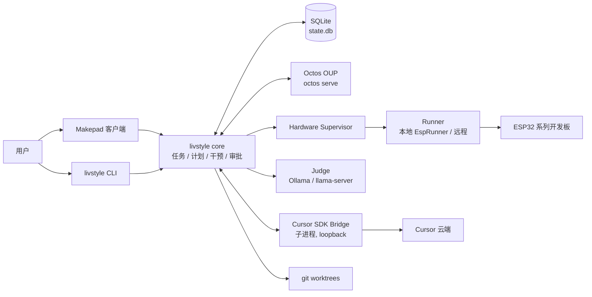

# livstyle 技术设计

**版本：** v0.3（与 [PRD v0.3](PRD.md) 对齐，取代 v0.1）  
**状态：** Accepted for MVP-0/MVP-1 实施；未决项见 §16  
**日期：** 2026-10-18  
**ADR：** [docs/adr/](adr/)（ADR-001 ~ ADR-013）  
**代码：** 本仓库 `crates/`；本文中“已实现”指代码与测试已在仓库中，“计划”指尚未编码

> 与 PRD 冲突时以 PRD 为准。本文描述**怎么做**；**做什么、为什么做**见 PRD。

---

## 1. 决策摘要

1. **Makepad 只做展示和输入。** 所有状态机、审批、恢复逻辑在无 UI 依赖的 Rust crate 中，CLI 与 UI 共用，可以无头测试。
2. **产品状态唯一所有者是 livstyle Product Service**（本地 SQLite，ADR-011）。Octos 持有原生会话 / turn；Cursor 持有 Agent / Run；livstyle 只保存到它们的映射和游标。
3. **Cursor 是外部 Agent Runtime**，通过官方 Cursor SDK Bridge `sdk.v1` 接入（ADR-003），不伪装成 LLM Provider。
4. **硬件写操作只能经 Supervisor → Runner。** Runner 独立校验 fencing token、runner 身份、产物哈希和芯片（ChipCheck），不信任调用方（ADR-005）。
5. **每个可写的 Agent Run 在独立 git worktree 中执行**（ADR-012），合并回用户分支必须经过审阅。
6. **Jev 判断层是可选加速器**：只建议、不授权；不可用时退化为规则判断 + System Two，功能不变（ADR-009）。
7. **芯片 / 板卡差异全部数据化**（Chip / Board Profile，ADR-007），新增芯片不改 Runner 代码。
8. **ESP-IDF 工具链优先使用 EIM 安装**，按芯片最低版本做准入；esptool 取自所选 IDF 的 Python 环境（ADR-013）。

---

## 2. 系统上下文



进程模型（Linux 首发）：

| 进程 | 生命周期 | 说明 |
|---|---|---|
| `livstyle`（UI 或 CLI） | 用户启动 | 持有 SQLite、Supervisor、本地 Runner |
| `cursor-sdk-bridge` | 由 livstyle 按需拉起，随之退出 | 只监听 loopback，bearer token 每次启动生成 |
| `octos serve` | 用户或 livstyle 启动 | OUP over WebSocket；livstyle 不嵌入 Octos |
| Ollama / llama-server | 用户自行运行 | 仅 Judge 使用；不可用时自动退化 |
| esptool（IDF venv） | 每次硬件操作 | 由 Runner 以独立进程组运行，超时整组终止 |

---

## 3. Crate 结构

依赖方向自上而下，下层不得依赖上层；`domain`、`profiles`、`steering` 不做 IO。

| Crate | 职责 | 状态 |
|---|---|---|
| `livstyle-domain` | 任务状态机、计划依赖图与输入摘要失效、R/V 等级 | 已实现 |
| `livstyle-profiles` | Chip / Board Profile schema、注册表、revision 规则 | 已实现 |
| `livstyle-hardware` | 租约 / fencing、精确审批、Supervisor 状态机、Runner 契约、Mock Runner | 已实现 |
| `livstyle-steering` | 干预记录与队列、Judge 接口、规则 Judge、干预 → 动作解析 | 已实现 |
| `livstyle-http` | 仅限 loopback 的最小 HTTP/1.1 客户端（Bridge、Judge 共用） | 已实现 |
| `livstyle-secrets` | 凭据存储（0600 文件 + 环境变量覆盖），`Secret` 不可打印 | 已实现 |
| `livstyle-cursor` | Bridge 定位 / 启动 / 关闭，`sdk.v1` Connect-JSON 客户端，流与错误映射 | 已实现 |
| `livstyle-judge` | Jev 方法的 logprob Judge、后端适配、评测（准确率 / ECE / 延迟） | 已实现 |
| `livstyle-store` | SQLite 持久化：任务 CAS、计划修订、干预、操作、审计哈希链、恢复 | 已实现 |
| `livstyle-workspace` | 每个 Run 的 git worktree、单写者锁、变更汇总 | 已实现 |
| `livstyle-esp` | IDF 工具链探测、sysfs 串口发现、`EspRunner`、被动串口日志 | 已实现 |
| `livstyle-cli` | `livstyle` 命令：auth / cursor smoke / judge eval / toolchain / devices / chip-info | 已实现 |
| `livstyle-octos` | OUP 客户端：会话、turn/steer、steer_dropped、interrupt、restart_from_node | 计划（Spike 2） |
| `livstyle-core` | 编排：把上述 crate 组合为 Product Service（任务推进、干预管线、恢复） | 计划（MVP-0） |
| `livstyle-app` | Makepad UI | 计划（MVP-0） |

**依赖策略：** 只用本地缓存可得、成熟的 crate（serde、rusqlite bundled、sha2、clap、rpassword、libc）。HTTP 客户端自写，因为只访问 loopback、只需 HTTP/1.1 + chunked，且拒绝非 loopback 主机是安全要求（凭据不得被误发到外部）。

---

## 4. 领域模型

### 4.1 任务状态机（已实现：`livstyle-domain::task`）

```
Draft → Planning → Ready → Running ⇄ Paused
                    ↑        ↓
                    └── Replanning ← (amend_requirement)
Running → AwaitingApproval → Running
Running → Verifying → Completed | Failed
任意非终态 → Cancelled；硬件结果未知 → NeedsReconciliation
```

- 每次迁移带 `expected_version`，与存储层 CAS 一致（§5.2）；
- `amend_requirement` 记录需求差异与修订号，进入 `Replanning`。

### 4.2 计划依赖图与快速重编排（已实现：`livstyle-domain::plan`）

- `PlanNode { id, kind, deps, inputs: {key → digest}, interruptibility, status }`；
- `Plan::new` 做拓扑校验（无环、依赖存在）；
- `apply_input_changes({key → new_digest})`：输入摘要变化的节点及其**传递下游**被作废，返回 `PlanDiff { kept, invalidated, interrupted, updated_pending }`；
- 输入键约定：`req.<field>`（需求条目）、`sdkconfig`、`idf_target`、`board_profile`、`artifact`、`assertions`……摘要用 SHA-256（规范化 JSON）。

AC-12 的两种情形由此直接得到：只改日志断言 → 只有 `assertions` 下游（Assertions、Report）失效；改 `sdkconfig` / `idf_target` → Build 及其下游全部失效，旧 artifact 摘要变化又使审批失效（§8.2）。

### 4.3 干预（已实现：`livstyle-steering`）

```
用户输入 ──► persist(received) ──► Judge(可选) ──► resolve(caps, stage, policy) ──► 动作
                     │                    │ 失败/超时                         │
                     │                    └──► RuleJudge ────────────────────┘
                     └──► 恢复后重放所有未结清记录（AC-11）
```

- 记录先落库再判断，任何异常都不会丢输入；
- `resolve` 输入：`Judgment`、`RuntimeCaps { steer, interrupt }`、当前 `Stage`（空闲 / 运行中 / 硬件写入中）、`ResolvePolicy { apply_threshold: 0.8, hw_flag_threshold: 0.2 }`；
- 输出 `Resolution::Apply(Action) | Confirm(Action, reason) | Queue | Reject`；`touches_hardware_params ≥ 0.2` 一律 `Confirm` 并走重新审批；
- `on_steer_dropped`：Octos 在 turn 终止前退回未吸收的输入，按原顺序重新排队；`on_turn_completed`：把排队项交给下一次发送。

---

## 5. 持久化（ADR-011，已实现：`livstyle-store`）

### 5.1 选型

单文件 SQLite（rusqlite，`bundled` 静态链接，三平台一致），WAL + `synchronous=FULL` + `foreign_keys=ON`，`PRAGMA user_version` 迁移；遇到比当前程序新的 schema 拒绝打开。位置：`$XDG_STATE_HOME/livstyle/state.db`（Linux），Windows 为 `%LOCALAPPDATA%\livstyle\state.db`。

领域对象以 JSON 文档存储，旁边只放查询与并发控制需要的列，避免每次领域字段变化都迁移表结构。

### 5.2 表

| 表 | 关键列 | 规则 |
|---|---|---|
| `tasks` | `id, version, status, doc` | `UPDATE … WHERE version = ?` 乐观并发；冲突返回 `Conflict{expected, actual}` |
| `plans` | `(task_id, revision), doc, reason` | 只追加；每次重编排一个修订，可回看计划差异 |
| `interventions` | `id, task_id, seq, input, status, judgment, resolution` | 输入先落库；`pending_interventions` 返回未结清项供恢复 |
| `operations` | `id, op_type, params_digest, device_id, state, fencing_token, detail` | 状态迁移白名单校验（见下） |
| `runtime_mappings` | `(task_id, runtime, kind), external_id, resume_offset` | Octos 会话、Cursor agent/run 与可恢复 offset |
| `events` | `seq AUTOINCREMENT, task_id, kind, payload` | 每个状态变化与业务写入在同一事务内追加；UI 按 `seq` 增量拉取 |
| `audit` | `seq, actor, action, subject, payload, prev_hash, hash` | 哈希链（长度前缀 SHA-256）；触发器禁止 UPDATE/DELETE；`verify_audit_chain` 可检测篡改 |

### 5.3 硬件操作状态迁移

```
Prepared → Authorized → Dispatched → Succeeded | Failed | Cancelled | OutcomeUnknown
Prepared/Authorized → Cancelled
OutcomeUnknown → Succeeded | Failed     （仅限消歧：回读校验或用户确认）
```

**启动恢复：** `recover_inflight_operations()` 把所有 `Dispatched` 标为 `OutcomeUnknown` 并返回给 Supervisor 提示用户消歧；`OutcomeUnknown` 不允许回到 `Dispatched`，从存储层保证“不自动重烧”（AC-04）。

---

## 6. Runtime 适配层

### 6.1 统一抽象（计划：`livstyle-core::runtime`）

```rust
trait AgentRuntime {
    fn capabilities(&self) -> RuntimeCaps;           // steer / interrupt / resume
    fn start(&self, task: &TaskCtx, prompt: &str) -> Result<RunHandle>;
    fn steer(&self, run: &RunHandle, text: &str) -> Result<SteerAck>;   // 不支持时返回 Unsupported
    fn interrupt(&self, run: &RunHandle) -> Result<()>;
    fn observe(&self, run: &RunHandle, after: Option<Offset>) -> Result<EventStream>;
}
```

规范化事件：`TextDelta`、`ToolCall{name, args}`、`ToolResult`、`StatusChanged`、`SteerDropped(inputs)`、`Finished(summary)`、`Failed(error)`。

### 6.2 Octos（计划：Spike 2）

- OUP over WebSocket；`turn/steer` 带 `expected_turn_id`，被拒（turn 已变）时排队；
- 订阅 `event.turn_steer_dropped.v1`，映射到 `InterventionQueue::on_steer_dropped`；
- `turn/interrupt`（取消步骤）、`task/cancel`（取消任务）、`task/restart_from_node`（重编排后从首个失效节点继续）；
- 已知限制：无 LLM Provider 时 `octos serve` 不能建会话（`profile.rs:1033`），Cursor-only 模式由 livstyle 直接编排 Cursor，不经过 Octos。

### 6.3 Cursor（已实现：`livstyle-cursor`，ADR-003）

**定位与安装：** 版本锁定 `v1.0.38`。查找顺序：`LIVSTYLE_CURSOR_BRIDGE_BIN` → `$XDG_DATA_HOME/livstyle/cursor-sdk-bridge/v1.0.38/bin/cursor-sdk-bridge`；校验 `manifest.json` 中 `protocol = sdk.v1`。安装脚本 `scripts/fetch-cursor-bridge.sh` 的 SHA-256 写死在脚本里，不信任下载下来的 SHA256SUMS。

**启动：** 子进程环境只注入 `CURSOR_API_KEY`（如已配置）；从 stderr 读取 `cursor-sdk-bridge ready {json}`（schemaVersion 1、tcp、connect、url、authTokenFile），30 s 超时；读取 token 文件得到 bearer token。stderr 由后台线程持续排空，只保留最近 200 行用于诊断，**ready 行不进入诊断缓冲**。`Drop` 时先发 `Shutdown` RPC，5 s 后强杀。

**传输：** Connect 协议 JSON 模式，HTTP/1.1。一元调用 `POST /sdk.v1.<Service>/<Method>`，`application/json`；服务端流 `application/connect+json`，帧为 1 字节 flag + 4 字节大端长度，flag `0x02` 为结束帧（可能携带 `error`）。每次请求都带 `Authorization: Bearer <token>`。

**认证：** API Key 在每个接受它的调用中显式传入（CreateAgent / ResumeAgent / Catalog），同时放进 Bridge 环境。客户端在本地发现未配置 Key 时直接返回 `Auth`，不发请求。

**流：** `RunStream` 迭代器跳过 keepalive（约 15 s 一次的空 envelope），记录 run_id / agent_id / 最后的 status 文本；**只有 `ObserveRun` 流的 offset 可用于恢复**（`Send` 流的 offset 编号不同，`resume_offset()` 对其返回 `None`）。Bridge 重启后按 `runtime_mappings.resume_offset` 调 `ObserveRun(after_offset)` 续看。

**取消：** 在另一条连接上调 `CancelRun(run_id, agent_id)`；原流以 `Cancelled` 结果结束。

**错误映射：** `SdkErrorDetails`（`details[].value` 中的 base64 protobuf）手写解码，0–21 号错误码映射为 `Auth / Quota / RateLimited{retry_after} / Busy / NotFound / Invalid / Rpc`；未带 details 的 `unauthenticated` 判定为 **Bridge token 问题**（`BridgeUnauthenticated`），而不是 Cursor Key 问题，两者给用户不同的提示。

**能力：** v1.0.38 的 capabilities 为 `agent.create, agent.resume, agent.send, run.observe, run.wait, run.cancel, agent.management, cursor.catalog, artifacts.chunked, agent.usage`。**没有运行中注入**，因此 `RuntimeCaps { steer: false, interrupt: true }`：`append_context` 排队到下一次 Send，`amend_requirement` = Cancel + 重编排 + 新 Run（PRD §8.4）。

**Spike 1 现状：** 无 Key 部分已在真机验证（启动 0.2 s、Ping、GetVersion、错误 token → `BridgeUnauthenticated`、无 Key → 本地 `Auth`、Shutdown 退出），见 `crates/livstyle-cursor/tests/bridge_live.rs`。需要 Key 的部分（Me、ListModels、CreateAgent、Send 流、CancelRun、ObserveRun 续看、CloseAgent）由 `livstyle cursor smoke` 一条命令完成，等待用户录入 Key 后运行。

---

## 7. Judge（ADR-009，已实现：`livstyle-judge`）

### 7.1 方法

沿用 jev-rs 的 System One 思路，但在 Rust 内原生实现，不引入额外二进制：

1. 把任务状态渲染为共享前缀（任务、当前步骤、计划、用户新输入）；
2. 每个类型化问题作为后缀，选项用字母 `A..H` 标注，助手轮以 `Answer:` 结尾；
3. 只取**下一个 token 的 top-k logprobs**，不解码；
4. 在选项字母上做受限 softmax（合并 `" B"` / `"B"` / `"**B"` 等变体，top-k 中缺席的选项给最小 logprob − 2 的底值），可选按桶（问题类型 / 选项数）温度校准；
5. `label_mass`（落在选项字母上的原始概率质量）偏低说明模型“想说别的”，作为额外的不确定信号。

问题集：`intent`（8 选 1）、`scope`（4 选 1）、`touches_hardware_params`（是 / 否）、`invalidates_artifact`（是 / 否，可关闭以省一次调用——是否重建最终由计划图的输入摘要确定性决定）。

### 7.2 后端

| 后端 | 接口 | 说明 |
|---|---|---|
| `OllamaRaw`（默认） | `POST /api/generate`，`raw: true, logprobs: true, top_logprobs: 20, num_predict: 1, temperature: 0` | 自行套 ChatML 模板并预填空的 `<think>` 块，避免推理模型先输出换行 |
| `OpenAiCompat` | `POST /v1/chat/completions`，`logprobs, top_logprobs, max_tokens: 1` | llama-server / vLLM；模板由服务端套用，首 token 可能是空白，效果较差 |

Cursor SDK 不提供 logprobs，不能作为 Judge 后端。

### 7.3 实测（Spike 4）

环境：Linux，Ollama 0.24，`hf.co/hesamation/Qwen3.6-35B-A3B-Claude-4.6-Opus-Reasoning-Distilled-GGUF:Q6_K`，温度 1（未校准），样本 `evals/interventions.jsonl`（112 条，8 个 intent 各 14 条，中英混合），报告在 `evals/results/`。

| 配置 | 后端调用 / 条 | intent 准确率 | ECE | ≥0.8 覆盖 / 准确 | scope | 硬件标记 / 漏报 | p50 / p95 |
|---|---|---|---|---|---|---|---|
| `RuleJudge` | 0 | 49.1% | 0.211 | 14.3% / 93.8% | 46.4% | 83.9% / 0 | < 1 ms |
| 4 问（intent、scope、hw、artifact） | 4 | 92.0% | 0.031 | 87.5% / 98.0% | 51.8% | 95.5% / 0 | 8.9 s / 9.2 s |
| **默认**（scope 由 intent 推出） | 2–3 | 92.0% | 0.031 | 87.5% / 98.0% | **80.4%** | 95.5% / 0 | **4.5 s / 6.9 s** |

由此确定的实现：

- **scope 由 intent 推出**：cancel_step → current_step，reprioritize → remaining_plan，pause / cancel_task → whole_task，side_question / new_task → unrelated，置信度沿用 intent；只有 append_context / amend_requirement 追问 scope。直接问 scope 时模型和标注者对“当前步骤 vs 剩余计划”的理解差异很大（51.8%），推导后升到 80.4%，同时少一次调用；
- **默认不问 invalidates_artifact**：是否重建由计划图输入摘要确定性决定，模型的回答不参与决策；
- **单题约 2.2 s**：35B MoE 在本机的首 token 成本主导；规则判断立即给出“已接收”和临时分类，Jev 结果异步到达后再决定是否自动执行；
- 硬件参数标记 0 漏报：`hw_flag_threshold = 0.2` 偏保守是有意的，误报只会多一次确认。

### 7.4 退化

Judge 返回错误（不可达、超时、无 logprobs）时，干预管线改用 `RuleJudge`，同时把输入交给 System Two（当前 Runtime 在下一个空闲点解释），UI 标注“慢路径”。Judge 结果与来源（模型、校准版本、概率）随干预记录落库，**从不进入审批依据**（AC-14）。

---

## 8. 硬件

### 8.1 Supervisor 与租约（已实现：`livstyle-hardware`）

- 租约：`LeaseManager::acquire(device, task, now, ttl)` 发放单调递增 `FencingToken`；续约 / 释放 / 过期均有测试；
- 审批：`Approval` 绑定 `OperationParams::digest()`（规范化 JSON SHA-256，包含操作类型、设备、runner、目标芯片与 revision 范围、Board Profile、artifact 哈希、分区区域与额外参数），参数任何变化都使旧审批失效；
- R0 直接允许，R1/R2 需要审批，R3/R4 在 MVP 中拒绝；
- 写操作不可中断：运行中收到取消只标记 `cancel_requested`，完成后停止后续节点；强制中断需二次确认，结果记为 `OutcomeUnknown`。

### 8.2 EspRunner（已实现：`livstyle-esp::runner`）

每次 `execute` 的顺序（全部发生在 Runner 内，不依赖 Supervisor 的检查）：

1. `runner_id` 必须是自己；
2. `FenceGuard::admit(device, token)`：低于已见最大 token 的请求拒绝；
3. 设备 → 串口映射存在且端口节点存在；
4. **Flash：** 载入 `build/flasher_args.json`，重新计算所有镜像文件的哈希，组合为 `artifact_sha256`，与审批中的值比对，不一致拒绝（防止审批后产物被替换）；`flasher_args.json` 的芯片必须等于目标芯片；
5. **ChipCheck：** `esptool --before default-reset --after no-reset chip-id`，解析芯片与 revision，`chip_check(target, detected)`；不匹配直接拒绝，此时尚未写入任何字节（AC-10）；
6. 写入：`esptool --chip <c> -p <port> -b <baud> --before default-reset --after hard-reset write-flash <IDF 生成的参数> <offset file>…`；
7. 结果：退出码 0 → `Completed`；非 0 且输出中尚未出现写入 / 擦除 → `Failed`（设备未变）；已开始写入、超时或进程无法监管 → `OutcomeUnknown`。

esptool 方言：IDF ≥ 6 自带 esptool v5（本机为 v5.3.1，kebab-case 子命令），IDF 5.x 为 v4（snake_case），按所选 IDF 主版本自动切换。esptool 在独立进程组中运行，超时整组 `SIGKILL`，避免残留进程占住串口。

`ReadLog` 为被动采集：`O_NOCTTY` 打开、立即清除 DTR/RTS、关闭 `HUPCL`、raw 模式，按时长和字节上限读取；部分 USB-UART 桥在打开瞬间仍可能抖动，Board Profile 中注明。`Erase*` / `WriteEfuse` 在本版本返回 `Unsupported`。

### 8.3 设备发现（已实现：`livstyle-esp::devices`）

只读 sysfs：`/sys/class/tty/{ttyACM*,ttyUSB*}` → 向上找到含 `idVendor` 的 USB 设备节点，读取 VID/PID/serial/manufacturer/product 和 USB 拓扑路径。**发现过程不打开串口**（打开串口可能复位开发板，属于 R2 效果）。

设备 ID：有 USB 序列号时为 `usb-<vid>-<pid>-<serial>`（USB-Serial-JTAG 的序列号是芯片 MAC，跨端口稳定），否则为 `usbpath-<拓扑路径>`。桥接芯片分类：Espressif USB-Serial-JTAG（303a:1001）、Espressif 原生 USB、CP210x、CH340、CH343、FTDI。

注意：C3 / C5 / C6 / S3 的 USB-Serial-JTAG 都是 303a:1001，**VID/PID 无法区分芯片**，必须经 `chip-info`（会复位开发板，需用户确认）或首次 ChipCheck 才能绑定 Board Profile。

### 8.4 计划中

- `livstyle-core` 中把 Supervisor 的内存状态机与 `livstyle-store::operations` 合并（当前两者各自有测试，尚未连接）；
- 远程 Runner：同一 `Runner` 契约经 mTLS 暴露，FenceGuard 在远程端执行；
- 回读校验（`verify-flash`）作为 `OutcomeUnknown` 的自动消歧手段，本身是 R0。
- 板子结构 3D 观察（PRD §11.5）：照片或摄像头识别板子、排针和外设，显示在工作台「板子调试」折叠框。未实现；该框目前只追加串口扫描和芯片识别文本。视觉结果不得单独批准硬件写入。

---

## 9. ESP-IDF 工具链策略（ADR-013，已实现：`livstyle-esp::toolchain`）

1. **探测顺序：** 读取 `~/.espressif/tools/eim_idf.json`（Espressif Installation Manager），列出全部安装并采用 `idfSelectedId`；若环境中显式导出了 `IDF_PATH`，则它优先（用户已在 IDF shell 中）。
2. **版本以源码树为准：** 解析 `tools/cmake/version.cmake` 的 `IDF_VERSION_MAJOR/MINOR/PATCH`，不信任目录名。
3. **按芯片准入：** `Toolchain::supports(chip)` 要求所选 IDF ≥ `chip.idf.min_version`（例：C5 ≥ 5.5，P4 ≥ 5.3）。不满足时规划阶段即报错并给出升级提示，而不是等到编译失败。
4. **执行环境：** `idf.py` 通过 EIM 的 activation script 在 `bash -c` 中执行，与用户自己 shell 的 PATH、`IDF_PYTHON_ENV_PATH` 完全一致；esptool 直接用该 IDF 的 venv Python（`python -m esptool`），保证与生成 `flasher_args.json` 的 IDF 匹配。
5. **espflash / probe-rs** 只作为可选工具显示，不在 Runner 关键路径上。
6. **Profile 驱动的配置默认值（计划）：** 实测发现 IDF 示例在 C5 上默认按 2 MB flash 编译，而 ESP32-C5-DevKitC-1 为 8 MB。规划器必须根据 Board Profile 生成 `sdkconfig.defaults`（`CONFIG_ESPTOOLPY_FLASHSIZE_*`、PSRAM、控制台），这些值同时作为计划节点的输入摘要。
7. **锁定：** MVP 验收固定 ESP-IDF v6.0.2（本机 EIM 安装），记入 EvidenceBundle。

本机实测：IDF v6.0.2（EIM），esptool v5.3.1，openocd-esp32 v0.12.0-esp32-20260424；`hello_world` 以 `esp32c5` 为目标编译成功（19 s），产出的 `flasher_args.json` 被 `FlasherArgs::load` 正确解析（3 个镜像：0x2000 / 0x8000 / 0x10000）。

---

## 10. Chip / Board Profile（ADR-007，已实现）

- `profiles/chips/*.toml`、`profiles/boards/*.toml`，`schema_version = 1`，全部 `deny_unknown_fields`；
- 有效支持级别 = min(板卡级别, 芯片级别)；
- **验收板卡：ESP32-S3-DevKitC-1（Xtensa）+ ESP32-C5-DevKitC-1（RISC-V）**；C3、C6 板卡已在手，纳入回归；P4、经典 ESP32 为 Experimental；
- 所有 Profile 当前 `provenance.status = "draft"`；在真实板卡上完成 `chip-info` 与 V3 后改为 `verified` 并记录来源。C5 的引脚分配特别标注待核对。

---

## 11. 工作区隔离（ADR-012，已实现：`livstyle-workspace`）

- 每个可写 Run 执行 `git worktree add -b livstyle/<run_id> <root>/<run_id> <base>`，`root` 在用户仓库之外；
- run_id 只允许 `[A-Za-z0-9_-]{1,64}`，杜绝路径穿越；
- 单写者锁：worktree 根目录下 `create_new` 创建 `.livstyle-lock`（记录持有者和 pid），`Drop` 释放；锁文件不出现在变更汇总中；持锁时禁止删除；
- `changes()`：`status --porcelain --untracked-files=all` + `log base..HEAD` + `diff base`（用 intent-to-add 让未跟踪文件出现在 diff 中，不暂存内容）；
- 删除时默认保留分支，便于事后审阅；`prune` 清理目录已消失的条目；
- Octos 与 Cursor 同一步骤写同一目录的冲突由“一个 Run 一个 worktree + 锁”消除；合并回用户分支是显式的审阅动作（UI 中的 Diff 视图 → 应用）；
- 非 git 目录：退化为 scratch 目录 + `lock_dir`，并在 UI 提示无法隔离。

---

## 12. 凭据（已实现：`livstyle-secrets`）

- 存储：`$XDG_CONFIG_HOME/livstyle/credentials.toml`，`[secrets]` 表，权限 0600，临时文件 + rename 原子写入；读取时若文件对组或其他用户可读则拒绝；
- 覆盖：环境变量 `LIVSTYLE_CURSOR_API_KEY` 优先（CI / 一次性使用）；
- `Secret`：`Debug` 输出为 `Secret(<redacted>)`，对外只显示 SHA-256 指纹前 8 位，Drop 时清零缓冲；
- 录入：`livstyle auth cursor` 用 rpassword 隐藏输入，**Key 不经过命令行参数**（避免进入 shell 历史与 `ps`）；`auth status` 只显示指纹与来源；
- Bridge token 与 Cursor Key 分开：token 每次启动生成，只在内存中；
- 后续：接入系统 keyring（Secret Service / Windows Credential Manager），文件存储作为回退。

---

## 13. UI 线框（Makepad，计划：`livstyle-app`）

### 13.1 主窗口

```
┌──────────────────────────────────────────────────────────────────────────────────┐
│ livstyle   [工作区: ~/proj/sensor ▾]   Runtime: Cursor ● 已认证 (a1b2c3d4)   ⚙   │
├───────────────┬──────────────────────────────────────────┬───────────────────────┤
│ 任务          │ 计划  rev 3  (因“改为 5GHz”重编排)       │ 设备                  │
│ ● WiFi RSSI   │                                          │ ESP32-C5-DevKitC-1    │
│   运行中 3/7  │  ✔ 分析需求                               │  /dev/ttyACM0         │
│ ○ PSRAM 修复  │  ✔ 生成 sdkconfig.defaults               │  esp32c5 v0.1         │
│   已暂停      │  ⟳ 构建 (idf.py build)   free            │  租约: 本任务 ⏱ 4:12  │
│ ○ Zigbee 传感 │  ◌ 审批烧录            ⚠ R2             │ ESP32-S3-DevKitC-1    │
│   草稿        │  ◌ 烧录                🔒 不可中断        │  /dev/ttyACM1  空闲   │
│               │  ◌ 启动日志采集                           │                       │
│ [+ 新任务]    │  ◌ 断言 & 报告                            │ [刷新] [识别芯片…]    │
│               │                                          ├───────────────────────┤
│               │  ── 计划差异 (rev2→rev3) ──               │ 干预                  │
│               │  保留 2 · 作废 3 · 中断 1                 │ #4 “改为 5GHz”         │
│               │                                          │   需求变更 0.97 → 已重编排│
│               │                                          │ #5 “串口是 ACM1”       │
│               │                                          │   补充上下文 → 已排队  │
├───────────────┴──────────────────────────────────────────┴───────────────────────┤
│ 日志 │ Agent │ Diff │ 证据                                                        │
│ [build] Linking CXX executable hello_world.elf …                                 │
├──────────────────────────────────────────────────────────────────────────────────┤
│ ▶ 随时输入：补充信息 / 修改需求 / 暂停 / 取消…                       [发送] [⏸] [■] │
└──────────────────────────────────────────────────────────────────────────────────┘
```

- 底部输入框任何时候可用；发送后立即在“干预”栏出现一条记录，状态依次为“已接收 → 判断中 → 已注入 / 已重编排 / 已排队 / 需确认 / 已退回”（AC-11）；
- 判断结果显示意图与置信度；低置信或涉及硬件参数时变为“需确认”卡片；
- 节点徽标：`free` / `safe_point` / `🔒 不可中断`；硬件节点显示风险等级。

### 13.2 干预确认卡片

```
┌ 需要确认 ───────────────────────────────────────────────┐
│ “把目标换成 C6 的板子”                                    │
│ 判断：修改需求（0.93） · 影响硬件参数（0.98）             │
│ 将会：取消当前 Run → 重编排 → 作废构建产物与烧录审批       │
│ 计划差异：保留 1 · 作废 5                                 │
│        [按此执行]   [仅补充为上下文]   [取消]             │
└──────────────────────────────────────────────────────────┘
```

### 13.3 烧录审批

```
┌ 审批：烧录 (R2) ─────────────────────────────────────────┐
│ 设备     ESP32-C5-DevKitC-1  usb-303a-1001-F0:F5:…  ACM0 │
│ 目标芯片 esp32c5  revision ≥ v0.1   Profile v1 (draft ⚠) │
│ 产物     bdec1b8a…  (3 个镜像)  源码 a1b2c3d (worktree)   │
│ 区域     0x2000 bootloader · 0x8000 分区表 · 0x10000 app │
│ 参数     dio / 80m / 8MB   波特率 460800                  │
│ 摘要     sha256 7f3e…（任何参数变化将使本审批失效）        │
│ ⚠ 烧录开始后不可中断；强制中断会进入“结果未知”             │
│                       [批准一次]   [拒绝]                 │
└──────────────────────────────────────────────────────────┘
```

### 13.4 结果未知消歧

```
┌ 烧录结果未知 ────────────────────────────────────────────┐
│ op-17 在写入 0x10000 时串口断开（12%）                    │
│ 设备状态无法确定，系统不会自动重烧。                       │
│  [回读校验 (R0)]  [我确认已成功]  [标记失败并重新审批]     │
└──────────────────────────────────────────────────────────┘
```

### 13.5 设置 · 认证

```
Cursor API Key   ● 已配置  指纹 a1b2c3d4  来源 credentials.toml   [更换] [移除]
Cursor Bridge    v1.0.38  sdk.v1  ✔ 已校验                       [重新安装]
Judge            Ollama http://localhost:11434  qwen3.6-35b-a3b   [测试] [评测…]
ESP-IDF          v6.0.2 (EIM) ✔   esptool 5.3.1   openocd ✔
```

Key 输入框为密码框，提交后只回显指纹；UI 进程把 Key 写入 `livstyle-secrets`，不放入任何日志或 Agent 上下文。

### 13.6 Makepad 实现要点

- 使用 makepad-widgets 2.0 `script_mod!` DSL（参考本地 `makepad/examples/counter`）；
- UI 线程不做阻塞 IO：Bridge、Judge、esptool、SQLite 写都在后台线程，经通道 + `SignalToUI` 唤醒 UI，UI 按 `events.seq` 增量刷新；
- UI 状态是 Store 的投影，重启后从 Store 重建，不在 UI 中保存权威状态。

---

## 14. 测试与验证

| 层次 | 命令 | 覆盖 |
|---|---|---|
| 单元 / 组件 | `cargo test --workspace` | 状态机、计划失效、审批摘要、租约 / fencing、干预解析、存储 CAS / 恢复 / 审计链、worktree 隔离、esptool 输出解析、EspRunner（脚本化 esptool）|
| Bridge 集成 | `cargo test -p livstyle-cursor --test bridge_live` | 真实 Bridge 进程，无需 Key；Bridge 未安装时跳过 |
| Spike 1 | `livstyle auth cursor` → `livstyle cursor smoke` | 需要用户 Key |
| Spike 4 | `livstyle judge eval --backend ollama --out evals/results/<name>.json` | 112 条中英文标注样本 |
| IDF 构建 | `LIVSTYLE_TEST_IDF_BUILD=<proj>/build cargo test -p livstyle-esp real_idf` | 真实 `flasher_args.json` |
| 硬件在环 | `livstyle devices` → `livstyle chip-info <port>` → 烧录 | 需接板、需用户确认；不进 CI |

故障注入（Spike 3）在 `livstyle-hardware/tests/safety.rs`（Mock Runner）和 `livstyle-esp` runner 测试（写入中断开、旧 token、产物被替换、芯片不符）中覆盖。

---

## 15. 跨平台

| 平台 | 状态 | 差异点 |
|---|---|---|
| Linux x64 | 首发 | sysfs 发现、termios 串口、EIM |
| Windows x64 | MVP-2 | 设备发现改 SetupAPI；串口改 Win32 COM；凭据改 Credential Manager；Bridge 有 win32-x64 构建；EIM 有 Windows 版 |
| macOS | 非目标，可编译 | Bridge 有 darwin 构建 |
| Android | MVP-3 远程客户端 | 不运行 Bridge / Runner / Judge，只连接受信任的桌面节点 |

---

## 16. 未决问题

1. Spike 1 需要 Key 的部分尚未运行；需确认账户套餐对 SDK 调用的计费方式。
2. Spike 2（Octos OUP 实测）尚未开始；`task/restart_from_node` 的语义需与计划图对齐。
3. Jev 默认模型：35B MoE 准确但慢，需要评估 3–4B 小模型的准确率 / 延迟折中（§7.3）。
4. C5 Board Profile 的引脚与 USB 桥接芯片需在实板上核对。
5. 回读校验能否覆盖所有 `OutcomeUnknown` 场景（分区表被部分写入时）。
6. Supervisor 内存状态机与 Store 的合并方式（单一事务边界）。
