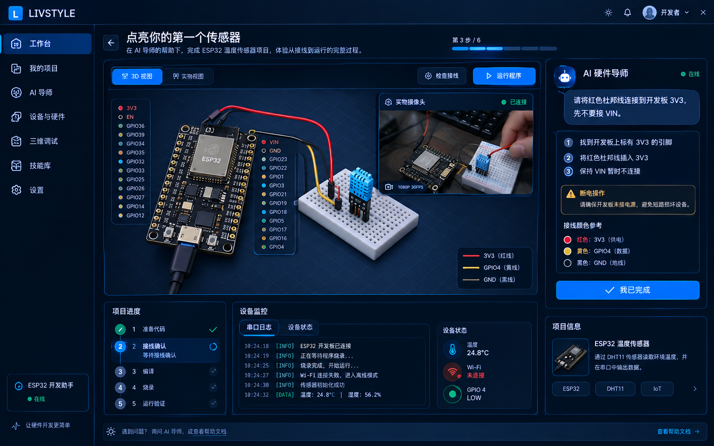

# livstyle：AI 硬件导师与 DIY 创作工作站

> **文档类型：** 产品定位 + PRD + 架构设计 + 技术实施路线 + Cursor 执行 Prompt  
> **版本：** v1.0  
> **目标代码仓库：** `https://github.com/livstyle/livstyle-bot`  
> **目标分支：** `master`  
> **Agent 基础：** Octos  
> **桌面 UI：** Rust + Makepad  
> **首个硬件方向：** ESP32  
> **后续方向：** 传感器、执行器、更多 MCU、RK3588 与其他 IoT 设备

本文档包含完整的六部分内容：产品定位、Octos 与 livstyle 的职责边界、Toit/Jaguar 技术路线、UI 设计、可直接交给 Cursor 执行的实施 Prompt，以及最终产品决策建议。UI 概念图位于同目录的 `livstyle_hardware_mentor_ui.png`。

---

# 第一部分：产品定位与核心体验

## 1. 产品定位

**产品名称：** livstyle  
**产品类别：** AI 硬件导师 / AI DIY 创作工作站

### 一句话定位

> 告诉 livstyle 你想做什么，它会带你认识开发板、连接元件、生成并运行程序、观察真实设备反馈，遇到问题后再带你一步步排查，直到作品真正工作。

livstyle 的目标不是开发另一个通用聊天机器人、代码编辑器、Agent 插件市场或 IDE，而是让没有硬件开发经验的人也能通过自然语言、逐步指导与真实设备反馈完成硬件 DIY 项目。

用户真正想要的是一个能够工作的作品，而不是 AI 生成的一份代码文件。

### 目标用户

第一阶段主要面向：

- 没有嵌入式开发经验的 DIY 用户。
- 电子爱好者、创客与学生。
- 想快速制作传感器、灯光、自动化装置的人。
- 手里有开发板和元件，但不知道如何接线、编译、烧录的人。
- 希望通过拍照、实时观察和逐步指导解决硬件问题的人。

后续可扩展至软硬件跨界开发者、教育场景、产品原型验证和专业开发辅助。

## 2. 核心体验：从“我想做什么”到“设备真的运行了”

例如，用户输入：

> 我想做一个可以监测房间温湿度的装置。

livstyle 应主动带用户完成以下过程：

1. **确认环境：** 帮用户确定开发板、传感器、供电方式和运行目标。型号不确定时询问或引导拍照识别，不直接猜引脚。
2. **指导接线：** 一次只指导一个主要动作，在图中高亮引脚、显示导线两端，提醒电压、极性、断电和短路风险。
3. **完成软件工作：** 自动创建项目、生成代码、检查依赖、编译并解释结果。Octos 负责 Agent 执行与编排；Cursor 可以作为可选代码开发后端。
4. **运行真实设备：** 检查串口、部署/烧录状态、设备日志和传感器数据；摄像头辅助观察 LED、屏幕或机械动作等可见现象。
5. **验证并诊断：** 将实际日志、当前步骤、设备状态和用户提供的图像交给 Agent，给出有根据的故障排查建议。
6. **交付作品：** 保存项目、硬件配置、接线方案、代码版本、运行日志和验证证据，方便复现与继续迭代。

### 产品差异化

livstyle 应吸收 Grok Bot 一类产品的主动任务执行、上下文连续性、技能复用与自动化理念，但不能止步于把聊天机器人放进硬件界面。

livstyle 的差异化应是：**对现实硬件世界负责，而不仅是完成数字世界里的任务。**

### 必须明确的证据原则

软件执行结果、设备观测和模拟效果必须区分：

- 编译成功不能代表设备已运行。
- 烧录命令返回成功不能代表设备功能正常。
- 摄像头画面不能单独证明固件烧录成功。
- 三维动画不能冒充实际电气状态。
- 真实设备日志、传感器数据、部署工具结果和必要的用户确认，才是验收的重要证据。

## 3. MVP 范围

第一版应只做一条端到端体验可靠的硬件路径，而非一开始支持所有板卡、所有工具链、任意 Agent 和完整 3D 仿真。

建议 MVP：

1. Windows/Linux 桌面端优先，以当前 Makepad 工程实际可构建的平台为准。
2. 一个经过验证的 ESP32 开发板配置。
3. 一个传感器项目模板，例如温湿度传感器。
4. 结构化硬件配置和引脚映射。
5. 一步一步的接线指导。
6. Rust 宿主侧的设备检测、构建/部署适配与串口日志。
7. Octos 作为 Agent 基础。
8. 当前已有的 Cursor Agent 作为可选代码开发后端。
9. 构建进度、日志、设备状态和成功证据。
10. Toit/Jaguar 作为适用 ESP32 项目的可选快速迭代路径。

第一版不承诺：

- 自动识别任意未知开发板并保证所有引脚判断正确。
- 自动识别任意实物电路并准确判断所有导线。
- 支持所有 MCU、工具链与烧录协议。
- 对任意项目做真实电气仿真。
- 仅依靠摄像头证明所有运行状态。
- 一次性实现完整的三维实时数字孪生。
- 重写完整的通用 Agent Runtime。
- 用通用插件市场取代硬件主工作流。

---

# 第二部分：以 Octos 为基础的架构与产品边界

## 4. 基本原则

Octos 已经提供 Agent 执行、上下文、工具、记忆、技能、工作流和 Agent 协调等基础能力。livstyle 应围绕这些能力构建硬件产品体验，而不是重新实现一套平行的 Agent 系统。

建议分工：

| 层次 | 职责 |
|---|---|
| Octos 内核 | Agent 执行、上下文、工具调用、记忆、技能、工作流、模型路由等已有能力。实际复用范围以当前源码为准。 |
| livstyle 产品层 | DIY 项目、硬件配置、步骤状态、接线方案、主动引导、设备任务编排与验证证据。 |
| Cursor Agent 适配器 | 可选的代码编写、代码修改和开发任务后端，不是整个产品的总调度中心。 |
| 硬件执行层 | 设备发现、构建、烧录、OTA 更新、串口日志、设备状态采集和结果验证。 |
| 视觉与三维层 | 摄像头、实物辅助识别、接线图、板卡三维展示和基于证据的动态调试视图。 |

产品中只应有一个让用户感知到的 AI 导师。底层究竟使用 Octos 还是 Cursor，应由任务路由和执行适配层决定，不要求新手理解 Agent Runtime。

## 5. Octos 与 Cursor 的职责

### Octos

优先复用当前项目实际存在的 Octos 能力，例如：

- Agent 执行循环与上下文管理。
- 工具注册和调用。
- 记忆与检索。
- Skill / Plugin 集成。
- Workflow 与任务监管。
- 模型 Provider 和路由。
- OUP 或项目已有的 UI/runtime 通信机制。

不要仅为接入 Cursor 就把完整 Cursor Agent 塞进 `octos-llm` 当作普通模型 Provider，也不要未经审计就修改 Octos 核心。

### Cursor Agent

Cursor 是可选的代码开发后端，主要用于：

- 阅读和修改项目代码。
- 生成或调整嵌入式代码。
- 修复构建和测试问题。
- 解释代码变更。
- 执行当前集成方式明确允许的开发工具操作。

Cursor 生成代码或报告成功，不等同于硬件任务完成。硬件步骤、权限、设备状态和验收证据应由 livstyle 产品层与硬件执行层控制。

### 产品层工作流

推荐的数据流：

1. 用户提交创作目标。
2. 产品层创建 HardwareProject。
3. Octos 使用已有 Agent、工具、记忆、技能和工作流能力参与规划。
4. 产品层将规划结果约束为经过校验的结构化项目步骤。
5. 用户完成必须亲自执行的物理操作。
6. 产品层收集可验证的状态。
7. Octos 分析事件并安排下一步。
8. 需要复杂代码修改时，可按配置委派给 Cursor。
9. 构建/部署适配器返回真实结果。
10. 设备监控、串口日志、传感器或摄像头等来源产生观测证据。
11. 产品层按照确定性验收条件判断状态。
12. Agent 根据结果继续指导，直到达到成功条件或明确阻塞。

不要仅用一个很长的 Prompt 驱动整个流程。每个关键阶段都应有明确输入、输出、成功条件、失败处理与必要授权。

---

# 第三部分：Toit/Jaguar 与减少物理操作的技术路线

## 6. Toit 的定位

Toit/Jaguar 可以成为减少 ESP32 重复插拔 USB 的重要路径，但不能视为通用烧录方案。

参考资料：

- Toit 源码：https://github.com/toitlang/toit
- Toit 设备入门：https://docs.toit.io/getstarted/device/
- Jaguar：https://github.com/toitlang/jaguar

Toit 面向特定支持的 ESP32 运行环境。Jaguar 可在设备完成必要初始配置后，通过本地 Wi-Fi 更新和重启应用。首次初始化仍可能需要串口连接、安装初始运行时/固件和配置网络。

因此，livstyle 应将设备更新方式抽象为多种能力：

- **SerialFlash：** 串口初始化或固件更新。
- **ToitJaguarOta：** 仅用于已验证兼容的 ESP32 与 Toit/Jaguar 环境。
- **OtherOta：** 为后续其他 OTA 方式保留扩展点。
- **RemoteDeploy：** 为后续支持的远程部署方式保留扩展点。

具体名称可按照项目已有的 Rust 命名规范调整。

## 7. Toit/Jaguar 实施要求

1. 明确列出经过验证的开发板、固件与工具链版本。
2. 首次初始化时，引导用户完成必要的 USB/串口连接、初始安装和 Wi-Fi 设置。
3. 首次部署成功后，记录设备身份、Jaguar 状态与网络连接状态。
4. 后续代码更新优先走已验证的网络更新路径，尽量减少拔插 USB。
5. 设备离线或 OTA 失败时，解释原因并给出安全的串口恢复步骤。
6. 不要未经用户同意自动将 Arduino、ESP-IDF 或 C/C++ 项目转换为 Toit。
7. 不得宣称所有 ESP32、第三方库和固件都适用 Toit。
8. 更新必须可观测、可取消，并返回真实执行结果。

目标是减少反复插拔，而不是声称可以完全消除所有物理连接。

## 8. 硬件执行层

在项目真实架构中复用或新增合适的能力接口，至少覆盖：

- 本机设备发现。
- 串口可访问性检查。
- 板卡识别或用户确认的型号记录。
- 工具链检测。
- 项目构建。
- 固件或应用部署。
- 串口监控。
- 运行日志解析。
- 设备状态与传感器数据采集。
- 断连、取消和资源清理。
- 执行结果与审计记录。

要求：

- 通过受控的 Rust 接口封装构建、烧录和部署工具。
- 不把所有工具调用塞在 UI 按钮回调里。
- 外部程序调用使用独立参数数组，不拼接不可信 shell 字符串。
- 校验工作目录、输入文件和目标设备。
- 结构化处理 stdout、stderr、退出码、超时和中断。
- 不把执行失败伪装成成功。
- 没有真实设备时，可以测试适配器与流程，但必须明确标记模拟结果。

---

# 第四部分：硬件模型、视觉、3D 与 UI 设计

## 9. 结构化硬件知识

Agent 不能临时凭自然语言猜测接线方案。需要结构化、可版本化的硬件资料模型。若项目已经存在类似结构，必须优先复用。

### BoardProfile

至少包含：

- `board_id`
- 名称和芯片系列
- 已验证的硬件修订
- 引脚清单与功能能力（GPIO、ADC、UART、I2C、SPI 等）
- 供电要求、电气限制与禁用组合
- 支持的构建、烧录和更新模式
- 兼容工具链版本
- 板卡图片与可选 3D 资源引用
- 资源来源和版本

### ComponentProfile

至少包含：

- `component_id`
- 类型和型号
- 供电范围
- 引脚定义
- 接口与协议
- 驱动或库要求
- 使用注意事项
- 图片及可选三维模型

### WiringPlan

每条连接至少包含：

- `from_component`
- `from_pin`
- `to_component`
- `to_pin`
- `wire_color`
- 必需的适配器、电阻或外围元件
- 电源域
- 安全约束
- 用户要执行的操作
- 连接完成的验证方式

这是结构化连接清单，不应只存一段 AI 自由文本。

### ProjectRecipe

保存可重用 DIY 项目的完整定义：

- 适用板卡与元件
- 所需工具与连接方式
- 接线清单
- 代码生成条件
- 依赖和构建配置
- 部署方式
- 预期日志或传感器信号
- 验收标准
- 常见故障和恢复路径
- 需要用户确认的高风险步骤

### HardwareSession

保存当前硬件开发进程：

- 当前项目与硬件配置
- 当前步骤
- 当前连接设备
- 构建任务
- 烧录/OTA 任务
- 串口会话
- 设备观测数据
- 当前授权
- 日志和验证证据

## 10. 硬件方案确定性验证器

验证器基于 BoardProfile、ComponentProfile 与 WiringPlan，而不是让另一个 LLM 自己判断方案是否安全。

至少检查：

- 引脚是否存在。
- 引脚是否支持目标功能。
- 是否存在已知引脚冲突。
- 供电电压是否满足元件要求。
- 是否存在已知不安全的电源连接。
- 是否缺少必要地线或电路元件。
- 配置是否匹配板卡型号。
- 工具链与更新方式是否受支持。
- 3D 模型、板卡配置与实物是否对应。

无法判断时返回“未知 / 需要确认”，不能默认安全。

## 11. 摄像头与实物识别

摄像头用于观察现实中的开发板和运行结果，不是唯一的设备状态来源。

### 第一阶段

- 用户主动启用摄像头。
- 显示实物预览。
- 允许用户拍照。
- 将图像附加到当前步骤。
- AI 根据图片提供辅助说明。
- 用户可以暂停、关闭或删除图像。

### 后续阶段

- 可选实时画面。
- 识别已支持的板卡类型。
- 识别已知模块与可见引脚标识。
- 比较照片和目标接线方案。
- 对明显接线错误提供提示。
- 识别已支持的可见反馈，如 LED 点亮、屏幕变化和机械动作。

视觉识别必须保留置信度。无法确定板卡型号、引脚或导线连接时，要求用户确认，不能让视觉模型凭猜测认定接线安全。

相机默认不持续上传。应明确告知图像如何处理，并提供暂停与关闭方式。

## 12. 3D 工作区与动态调试

不要从“完整数字孪生”开始。先用结构化硬件数据构建可靠视觉层。

### 阶段 A：2D 接线图

- 显示已支持开发板的引脚图和接线。
- 当前步骤高亮对应引脚和导线。
- 显示线材颜色、电源引脚和需要避开的风险区域。

### 阶段 B：基础三维模型

- 为已支持板卡和模块提供版本化的 3D/glTF 资源或其他经过验证的模型资产。
- 显示引脚和线材连接。
- 记录模型来源、版权和硬件适配关系。

### 阶段 C：可观测状态动画

将程序事件映射到三维视图，例如：

- 当前执行逻辑步骤。
- 传感器读取过程。
- GPIO 输出状态。
- 外设通信状态。
- 传感器返回数据路径。
- 已知设备告警。

每一项动态信息必须标记证据类型：

- `Observed`：真实串口、传感器或设备遥测结果。
- `Simulated`：依据程序逻辑或模型生成的模拟动画。
- `Expected`：理论预期或目标状态。
- `Unknown`：没有足够证据判断真实状态。

没有实际设备遥测时，不得把软件推断的 GPIO 状态显示为真实测得的电气状态。

### 阶段 D：照片辅助模型选择

允许上传开发板照片。系统识别候选板卡、让用户确认，再从真实板卡资源库加载对应模型。第一阶段不要承诺从任意照片直接自动生成精确的引脚级三维模型。

## 13. UI 设计：AI 硬件导师工作台

界面使用深色、清晰、科技感的 Makepad 工作站风格。主要区域如下：

### 左侧：项目和阶段

显示项目名称、当前设备和进度：

1. 需求确认
2. 硬件识别与准备
3. 接线
4. 代码生成
5. 构建与烧录/部署
6. 实时调试
7. 验收与保存作品

返回已完成步骤时，明确提示哪些后续步骤因配置改变而需要重新执行。

### 中间：硬件工作区

根据当前任务展示：

- 结构化接线图
- 开发板引脚图
- 可选三维视图
- 摄像头实物画面
- 构建/烧录/运行状态
- 在板卡或元件上定位的事件提示

第一版优先保证引脚映射和接线图准确，不以 3D 效果牺牲接线可靠性。

### 右侧：AI 导师

显示：

- 当前操作指令
- 此次操作要做什么
- 为什么要做
- 安全提醒
- 如何确认完成
- 当前验证结果
- 下一步建议
- “我完成了”和“我遇到问题”等交互

默认一次只引导一个主要动作，不要一次性输出 20 个步骤。

### 底部：实时状态与证据

显示：

- 设备连接状态
- 串口日志
- 构建与部署过程
- 传感器数据
- 运行诊断信息
- 最近错误
- 当前收集到的验证证据

普通用户默认看到简化状态；高级用户可以展开原始日志和详细错误。

### UI 概念图



> 该图是设计概念，用于指导布局与视觉语言，不是已实现的 Makepad UI。实际开发必须遵守当前项目的组件、状态和渲染架构。

---

# 第五部分：可直接复制给 Cursor 的完整实施 Prompt

以下内容可以直接复制到 Cursor Agent。建议在 `livstyle-bot` 仓库根目录打开 Cursor，并确保当前工作区是 `master` 分支。

---

## Cursor 执行 Prompt 开始

# livstyle 产品 PRD v1.0：基于 Octos 的 AI 硬件导师与 DIY 创作工作站

你现在担任 livstyle 的产品架构师、Rust 技术负责人、嵌入式开发工程师和交互设计师。请先审计当前工作区，并基于真实源码实现本 PRD。不要只输出方案或静态 UI 图。

产品目标不是开发另一个通用聊天机器人、代码编辑器或 Agent 插件市场，而是打造一个让没有硬件开发经验的人也能完成真实硬件 DIY 项目的 AI 创作平台。

主要项目：
- 应用仓库：https://github.com/livstyle/livstyle-bot
- 目标分支：master
- Agent 内核：https://github.com/livstyle/octos
- UI：Rust + Makepad
- 可选代码 Agent：当前项目已经集成或正在集成的 Cursor Agent
- 首个硬件方向：ESP32
- 后续硬件方向：更多 MCU、传感器、执行器与 RK3588

必须遵循的产品原则：

**让用户描述目标，让系统负责规划，让 AI 导师负责指导，让执行层负责操作，让真实设备反馈决定是否成功。**

不允许为了实现本 PRD 而另起一套与 Octos 平行的 Agent、Memory、Skill、Workflow 或 Plugin 核心系统。

## 1. 产品定位与 MVP

产品名称：livstyle。
产品类别：AI 硬件导师 / AI DIY 创作工作站。

用户输入一个目标，例如“我想做一个温湿度监测器”，系统帮助用户确认硬件环境、选择受支持板卡与元件、逐步接线、生成代码、构建、部署、观察设备反馈、诊断失败，并保存项目和验证证据。

首阶段聚焦一个经过验证的 ESP32 板卡配置与一个传感器项目。不要在 MVP 一次性支持所有芯片、工具链、任意摄像头识别和完整三维仿真。

首阶段功能：
- 创建 DIY 项目。
- 结构化板卡与组件配置。
- 一步一步的接线指导。
- 代码生成和构建。
- 真实设备部署/烧录适配。
- 串口日志与设备状态。
- 验收条件和证据记录。
- Octos 作为 Agent 内核。
- Cursor 作为可选代码 Agent 后端。
- 在受支持 ESP32 上可选 Toit/Jaguar 快速迭代路径。

## 2. 首先审计真实源码

先执行只读审计：

```bash
git status --short
git branch --show-current
git remote -v
```

不覆盖、不删除用户修改，不执行破坏性 git 命令。

读取：
- 根目录 `Cargo.toml`、`Cargo.lock` 和 README。
- 所有 workspace member 与 crate 职责。
- Makepad 启动流程、页面状态和消息传递方式。
- Octos 依赖、真实 API 和集成入口。
- Cursor Agent/SDK Bridge 适配器（如果已存在）。
- 现有工具注册、执行、hooks、权限检查。
- 已有的 memory、skills、plugin、workflow 和任务状态。
- 设备发现、串口、构建、烧录、OTA、日志和设置能力。
- 当前 CI、测试结构与实际平台目标。

先记录真实文件路径和调用关系，再开始修改。不能凭猜测写死 crate、trait、函数或文件名。

完成审计后继续实施，不要只返回审计报告。

## 3. 架构原则：Octos 是基础

先检查当前 Octos 版本与集成方式。优先复用实际已有的 Agent 执行、上下文、工具、记忆、Skill/Plugin、Workflow、任务监管、模型路由和 UI/runtime 协议。

livstyle 产品层负责：
- DIY 项目与硬件配置。
- 步骤状态和主动引导。
- 接线方案和硬件安全约束。
- 设备执行任务。
- 设备观测和验证证据。

Cursor Agent 是可选的代码开发后端。不要把 Cursor Agent 当作单纯的 LLM Provider 塞进 `octos-llm`，除非经源码审计证明当前架构确实需要相应的 Provider 扩展。不要为了接入 Cursor 大规模重写 Octos。

硬件执行层负责真正的编译、烧录、OTA、串口监控和设备状态。Cursor 生成代码或自然语言宣布成功，不等于硬件项目完成。

如果当前项目已经存在相关抽象，扩展并复用现有实现，避免建立重复的 Runtime、Task、Memory、Skill 或 Plugin 系统。

## 4. 结构化硬件数据模型

先检查已有模型，优先复用。只有不存在合适实现时才新增。

### BoardProfile

至少表示：
- 稳定 board ID。
- 名称、芯片系列和经过验证的硬件修订。
- 引脚清单和功能能力，例如 GPIO、ADC、UART、I2C、SPI。
- 供电要求、电气限制与禁用组合。
- 支持的构建、烧录与更新模式。
- 工具链版本要求。
- 板卡图片与可选 3D 资源引用。
- 来源、版本和适配信息。

### ComponentProfile

至少表示：
- 元件 ID、类型和型号。
- 供电范围、引脚定义、接口和协议。
- 驱动/库要求和使用注意事项。
- 图片与可选模型资源。

### WiringPlan

每条连接必须是结构化记录，至少包括：
- 起始组件与引脚。
- 目标组件与引脚。
- 线材颜色。
- 必需电阻、适配器或外围元件。
- 电源域和安全约束。
- 用户操作指令。
- 连接完成的验证方式。

### ProjectRecipe

保存适用硬件、接线清单、依赖、代码模板/生成约束、构建配置、部署方式、预期日志、验收标准、常见故障与恢复路径。

### HardwareSession

保存当前项目、硬件配置、当前步骤、设备连接、构建任务、烧录/OTA 任务、串口会话、观测数据、权限授权、日志和验证证据。

不要只将 AI 自由文本作为接线配置。结构化数据必须能被程序验证。

## 5. 硬件方案确定性验证器

实现或扩展一个确定性的硬件验证层，至少检查：
- 引脚是否存在。
- 引脚是否支持目标功能。
- 已知引脚冲突。
- 供电电压是否满足元件要求。
- 已知不安全的电源连接。
- 是否缺少必要地线或元件。
- 板卡型号与配置是否一致。
- 工具链和更新方式是否受支持。
- 3D 模型/图片是否匹配当前板卡配置。

验证结果基于 BoardProfile、ComponentProfile 和 WiringPlan，不依赖另一个 LLM 的判断。无法判断时必须返回“未知/需要确认”，不能默认安全。

## 6. AI 导师与步骤状态

AI 导师必须主动指导，不能只提供聊天回复。

每个步骤应有：
- 目标。
- 原因说明。
- 用户现在要做的动作。
- 需要的设备或工具。
- 可视化指示。
- 完成验证方式。
- 失败后的排查路径。
- 风险级别与必要授权。

默认一次只指导一个主要动作。用户可以确认完成或请求帮助。尽量用可观察状态验证操作，不要永远依赖用户自我声明。

当配置变化导致后续步骤失效时，提示用户哪些步骤需要重做。任务状态需要可恢复，不能仅靠超长 prompt 记住所有上下文。

## 7. 硬件执行层

复用当前项目能力或实现合适的受控接口，涵盖：
- 本机设备发现。
- 串口可访问性检查。
- 板卡型号记录或确认。
- 工具链检测。
- 项目构建。
- 固件/应用部署。
- 串口监控。
- 日志解析。
- 设备状态与传感器数据采集。
- 断连、取消、超时与资源清理。
- 执行结果和审计记录。

外部程序调用必须：
- 使用参数数组，不拼接未经校验的 shell 命令字符串。
- 校验工作目录、输入文件和目标设备。
- 结构化处理 stdout/stderr 和退出码。
- 支持超时与中断。
- 不将失败伪装为成功。
- 通过与 Makepad UI 解耦的后台任务运行，不阻塞 UI 线程。

## 8. Toit/Jaguar 快速迭代

参考：
- https://github.com/toitlang/toit
- https://docs.toit.io/getstarted/device/
- https://github.com/toitlang/jaguar

将更新方式抽象为多个适配器。Toit/Jaguar 只在经过验证兼容的 ESP32 与运行环境中可用。

要求：
1. 明确支持的板卡和版本。
2. 首次初始化时引导用户完成必要 USB/串口连接、初始安装和 Wi-Fi 配置。
3. 首次部署成功后记录设备身份、Jaguar 与网络状态。
4. 后续代码更新优先使用已验证的网络更新途径。
5. OTA 失败或离线时提供诊断和安全恢复路径。
6. 不经用户同意，不将 Arduino、ESP-IDF 或 C/C++ 项目转换为 Toit。
7. 不宣称所有 ESP32、库和固件都适用 Toit。
8. 更新应可观测、可取消，并返回真实状态。

## 9. 摄像头与图像

第一阶段支持：
- 用户主动授权摄像头。
- 预览与拍照。
- 把图像关联到当前项目和步骤。
- 将图片作为辅助诊断输入。
- 暂停、关闭和删除图像。

后续再扩展实时画面、板卡识别、模块识别、接线比较和可见运行反馈识别。

必须保留识别置信度。无法确定板卡型号或引脚时要求用户确认。相机默认不持续上传。摄像头只能提供可见现象，不应单独作为固件部署成功的证明。

## 10. 三维调试视图

不要从完整数字孪生开始。

### 第一阶段：2D 接线视图
- 根据结构化引脚表显示接线图。
- 当前指导步骤高亮对应引脚和导线。
- 显示电源与风险提示。

### 第二阶段：已知板卡 3D 模型
- 使用经过验证的板卡/元件资源。
- 标注模型来源、版权、硬件修订和资源版本。
- 检查当前 Makepad 渲染架构和平台兼容性后再决定技术方案。

### 第三阶段：事件驱动的动态调试
- 将设备日志、GPIO 事件、传感器读数和外设状态关联到模型。
- 所有动态效果标注为 Observed、Simulated、Expected 或 Unknown。
- 没有真实遥测时，不得把推断的状态显示为真实测量结果。

### 第四阶段：照片辅助模型选择
- 识别候选开发板。
- 让用户确认型号和硬件修订。
- 从资源库加载对应模型。
- 不承诺通过任意照片直接产生精确的引脚级 3D 模型。

## 11. Makepad UI

先检查当前 Makepad 组件、状态和异步消息机制，不引入新的前端框架。

实现一个面向新手的项目工作台：

### 首页
- 自然语言输入：“你想做一个什么作品？”
- 新手项目卡片：点亮 LED、温湿度监测器、人体感应灯等。
- 最近项目和设备状态。

### 左侧阶段栏
- 需求确认。
- 硬件识别与准备。
- 接线。
- 代码生成。
- 构建与部署。
- 实时调试。
- 验收与保存作品。

### 中间硬件工作区
- 2D 接线图。
- 引脚图。
- 可选 3D 视图。
- 摄像头实物画面。
- 构建/烧录/运行状态。

### 右侧 AI 导师
- 当前指令和原因。
- 一个主要操作。
- 安全提示。
- 完成验证方式。
- 完成/求助交互。

### 底部运行面板
- 设备连接状态。
- 串口日志。
- 构建和部署过程。
- 传感器数据。
- 故障与验证证据。

UI 必须使用真实产品状态，不得只贴静态图片或硬编码成功状态。普通用户默认看简洁信息；高级用户可以展开原始日志与详细诊断。

## 12. 安全与隐私

所有真实设备操作必须通过独立设备执行层，不能让 Agent 通过通用 shell 绕过审批。

需要明确区分普通查询、代码修改、构建测试、固件烧录/部署、电源控制和不可逆操作。

需要用户确认的操作应展示目标设备、待执行内容、使用的固件产物、潜在影响、可逆性及如何获得结果。

接线指导应按已验证板卡资料提醒断电、电压、极性和短路风险。

摄像头、项目文件和设备日志都属于用户数据：
- 相机默认不持续上传。
- 明确说明图像如何处理。
- 提供暂停与关闭。
- 只传递诊断所需的最少数据。
- 密钥与 token 不进入普通日志。
- 不默认把整个项目上传到云端模型。

## 13. 实施阶段

### P0：源码审计

确认工作区、实际 Octos 集成、Cursor 适配器、Makepad UI 路径、硬件能力与测试结构。审计完继续实施。

### P1：项目状态与指导闭环

复用或实现 HardwareProject、ProjectRecipe、BoardProfile、ComponentProfile、WiringPlan、HardwareSession、步骤状态、验收条件和失败处理。

完成最小流程：建项目、选择板卡、看接线、生成/加载代码、构建、设备部署、看日志、验证和保存记录。

### P2：引导式 UI

完成首页创作入口、项目工作台、步骤列表、接线图、AI 导师、设备/日志面板和授权确认。

### P3：Octos 与 Cursor

复用现有 Octos 集成，让规划与工具使用关联项目步骤；Cursor 用于代码任务，但不能绕过硬件执行层的授权。

### P4：真实设备闭环

实现可验证的设备发现、工具链检测、编译、烧录/部署、串口监控、日志解析、取消和证据记录。

### P5：Toit/Jaguar

先核对文档和工具链，选定一个可以实际验证的 ESP32 配置。完成兼容检查、初始设置、网络更新、失败恢复与状态展示。

### P6：摄像头辅助

先实现用户授权、设备探测、预览、拍照与步骤关联，再扩展图像识别。无识别能力时不得伪造结果。

### P7：3D 视图

先完成结构化 2D 引脚图，再按 Makepad 兼容性实现一个板卡 3D 原型，映射接线和可观测设备事件。

### P8：测试与回归

确保 Octos 原有能力和 Cursor 任务继续工作；项目流程有真实状态；硬件前置条件和授权正确；摄像头未授权时不会启用；模拟状态不冒充真实设备观测。

## 14. 验收标准

### 项目创建

用户输入目标后可以创建项目；缺少关键硬件信息时会询问，不会假定所有条件已知。

### 硬件指导

已支持 Recipe 的接线清单正确显示每条连接的起始端和目标端；电气验证失败时不能默认通过；每一步可确认或求助，后续步骤依赖真实前置条件。

### 代码与执行

构建状态来自真实构建任务，部署状态来自真实工具返回，原始日志可查看，失败可诊断，不能把任务提交成功等同于设备运行成功。

### 实时反馈

真实串口、设备状态和已支持传感器数据能够展示并关联项目。缺乏测量证据时不能宣称物理状态已验证。

### 安全

取消有效；高风险操作需要授权；摄像头先授权；密钥不泄露；Agent 不能通过任意命令绕过执行层。

## 15. 测试和报告

根据实际 workspace 运行适用的格式检查、`cargo check`、`cargo test`、现有 CI 和目标平台构建。不得为了通过测试而删功能、弱化安全检查或伪造结果。

没有真实设备或凭据时，可以测试适配器与流程模拟，但要明确区分模拟与真实设备验证。

最后用中文报告：

1. 当前项目与 Octos 的真实架构审计结果。
2. 每项能力是已存在、复用、需要扩展还是尚未实现。
3. 实际新增/修改的文件路径与作用。
4. 产品工作流、硬件状态机和数据模型。
5. Octos 与 Cursor 的职责边界。
6. 真实设备执行路径与 Toit/Jaguar 适用范围。
7. UI 实现清单与未实现的视觉能力。
8. 安全、隐私与平台限制。
9. 实际构建、检查和测试命令及结果。
10. 尚未完成事项和阻塞原因。

不得创建无法运行的空实现，不得用假返回值伪装真实连接器，不得凭空捏造外部 API。遇到限制时如实说明，并继续完成不依赖该条件的工作。

现在从 P0 开始，完成审计后连续实施。优先让一个 ESP32 DIY 项目从自然语言需求走到真实设备可验证的闭环，然后再扩展相机识别、三维视图和更多设备类型。

## Cursor 执行 Prompt 结束

---

# 第六部分：最重要的三个产品决策

## 决策一：先跑通一个 ESP32 项目，不做万能平台起步

先让新手从“我想做一个温湿度监测器”走到真实设备读出温度和湿度。把这一条链路做好，再扩展更多模块和开发板。

## 决策二：Octos 做底座，硬件工作流成为 livstyle 的产品资产

Octos 已有的 Agent、工具、记忆、技能和工作流能力应尽量复用。livstyle 真正要建立的核心资产是：

- 可靠、结构化且可版本化的板卡资料。
- 可校验的接线规则。
- 受控的设备执行适配器。
- 面向新手的一步一步交互。
- 将代码、设备日志、真实观测和验收证据连在一起的工作流。

不要让产品的核心价值变成“又一个能调用很多工具的 Agent”。

## 决策三：3D 与视觉服务于任务，不为炫技而做

三维视图应帮助用户定位引脚、理解数据路径、看到当前步骤和查看对应的真实观测。摄像头应帮助用户理解实物与运行结果。

每个动画、状态和识别结论必须清楚区分真实测量、软件模拟、理论预期和未知状态。不能把漂亮的模型动画当作真实硬件调试。

---

# 参考链接

以下链接用于继续核对官方能力与实现细节。实现时需按当前固定版本再次确认协议和功能：

- Octos：https://github.com/livstyle/octos
- livstyle-bot：https://github.com/livstyle/livstyle-bot
- Cursor SDK：https://cursor.com/docs/sdk/typescript
- Cursor SDK Bridge：https://github.com/cursor/sdk-bridge
- Grok Bot 概览：https://docs.x.ai/grok-bot/overview
- Toit 设备入门：https://docs.toit.io/getstarted/device/
- Toit 源码：https://github.com/toitlang/toit
- Jaguar：https://github.com/toitlang/jaguar

> **实施底线：** 先做可靠的单一 ESP32 真实硬件闭环。不要以静态 UI、模拟成功状态、纯代码生成或未经验证的三维动画取代真实执行与设备证据。
